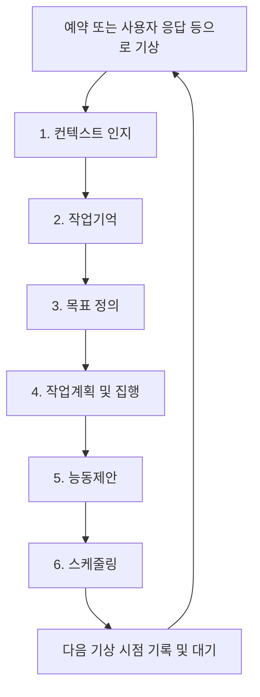

# 전체 동작 모델

## 1. 목적과 범위

> 사용자를 지속적으로 이해하고, 필요한 순간에 먼저 도움을 제안하며, 함께 목표를 이루어가는 개인 AI 비서를 만드는 프로젝트입니다.

Govis의 모든 모델과 활동은 이 목적을 대전제로 삼습니다. 각 모델은 목적 달성에 관련된 정보와 작업을 다루며, 사용자와 무관한 활동을 자체 목적으로 확장하지 않습니다.

이 문서는 전체 구조의 안내입니다. 세부 정의는 모델별 문서에 나누어 기록합니다. 현재는 추상 설계를 구체화하는 단계이며, 데이터 형식이나 구현 기술을 확정하지 않습니다.

## 2. 실행 주체와 작업공간

로컬 PC에 서비스 프로세스가 상주합니다. 이 프로세스는 비서의 지속적인 실행 주체이며, 사용자 정보와 맥락, 진행 중인 일, 활동 결과를 이어가는 작업공간을 관리합니다.

로컬 LLM은 사용하지 않습니다. 서비스 프로세스는 예약 시점이나 사용자 응답 등의 계기에 CLI 등의 호출 수단으로 원격 LLM을 호출합니다. 호출된 LLM은 구조화된 프롬프트와 도구를 통해 작업공간에 접근하고, 아래의 파이프라인을 수행합니다.

스케줄링 모델은 활동 마지막에 **LLM이 다음 기상 시점을 판단하는 단계**입니다. 예약은 다른 계기가 없어도 자율적으로 다시 활동하기 위한 장치이며, 유일한 기상 조건은 아닙니다.

서비스가 동작 가능한 상태에서 비동기 사용자 응답이 도착하면 즉시 새 회차를 시작합니다. 이전의 미래 기상 예약은 취소하고 새 회차 마지막에 예약을 갱신합니다. 즉시 대화 세션 안의 연속 메시지는 이 경우와 구분하며 세션·회차의 경계는 이후 정합니다. PC나 프로세스가 중단된 동안에는 활동하지 못하며, 다시 동작할 때 새 응답과 지난 예약의 필요성을 현재 상황에서 재검토합니다. 기상 예약의 변경이 사용자에게 약속한 작업의 기한이나 반복 조건을 취소하는 것은 아닙니다.

비서의 연속성은 프로세스와 작업공간을 통해 유지합니다. 원격 LLM을 호출하지 않는 동안에도 LLM이 계속 사고하는 것을 전제로 하지 않습니다.

## 3. 모델의 의미와 실행 순서

여기서 ‘모델’은 LLM이 깨어난 후 순차적으로 수행하는 **분리된 작업 단계**입니다. 각 단계가 별도의 LLM, 에이전트, 프로세스 또는 API 요청이어야 한다는 의미는 아닙니다.

전체 파이프라인은 사용자를 돕기 위한 일련의 인지·판단·실행 흐름입니다.

| 단계 | 핵심 질문 | 상세 문서 |
| --- | --- | --- |
| 컨텍스트 인지 | 마지막 상호작용 이후 무엇이 달라졌는가? | [정의 및 명세](모델/01-컨텍스트-인지-모델.md) |
| 작업기억 | 새 맥락을 반영해 무엇을 기억하고 이어가야 하는가? | [정의 및 명세](모델/02-작업기억-모델.md) |
| 목표 정의 | 현재 사용자를 위해 어떤 목표를 추구해야 하는가? | [정의 및 명세](모델/03-목표-정의-모델.md) |
| 작업계획 및 집행 | 지금 어떤 작업을 계획하고 실제로 수행할 것인가? | [정의 및 명세](모델/04-작업계획-및-집행-모델.md) |
| 능동제안 | 결과를 바탕으로 지금 사용자에게 무엇을 먼저 전달할 것인가? | [정의 및 명세](모델/05-능동제안-모델.md) |
| 스케줄링 | 다음에는 언제 깨어나야 도움이 되는가? | [정의 및 명세](모델/06-스케줄링-모델.md) |

관련 명세:

- [파이프라인 공통 명세](모델/00-파이프라인-공통-명세.md): 용어, 단계 간 전달, 공통 목적과 경계.
- [기간별 기억과 통합 판단](모델/07-기간별-기억과-통합-판단.md): 하나의 활동 루프에서 단·중·장기 기억을 구분하고 함께 참조하는 방식.
- [사용자 소통 방식](사용자-소통-방식.md): LLM이 맥락·긴급도에 따라 대화 형태와 주의 요청 강도를 선택하는 방식.

모든 단계에서 할 일이 없거나 변경이 불필요하면 간단히 통과하는 것이 정상입니다. 회차 중 발생한 결과는 기억에 반영합니다. 능동제안 단계에서는 LLM이 적절한 소통 방식을 선택해 정보·질문·제안을 전달하거나 즉시 대화를 엽니다. 비동기 응답은 다음 회차의 첫 단계에서 받아들이며, 즉시 대화는 세션 안에서 여러 차례 주고받을 수 있습니다. 이를 위해 여섯 단계의 순서를 변경하지 않습니다.

단·중·장기별로 독립된 활동 루프를 만들지 않습니다. 공통 맥락과 기간별로 구분한 기억을 하나의 활동 루프가 통합적으로 참조합니다.

## 4. 한 번의 활동 예시

사용자가 체중 관리를 위해 평소 18시에 야외 운동을 한다고 가정합니다. 시간과 생활 패턴은 예시이며 고정 규칙이 아닙니다.

1. **컨텍스트 인지:** 17시에 깨어나 최근 대화와 허용된 모바일 데이터를 확인하고, 이전 이후의 변화를 임시로 정리합니다.
2. **작업기억:** 운동 습관에 관한 기존 정보와 새 맥락을 대조하고, 이어서 살필 내용을 갱신합니다.
3. **목표 정의:** 체중 관리와 운동 지속이라는 목표가 현재도 유효한지 검토합니다.
4. **작업계획 및 집행:** 야외 운동에 도움이 되는지 판단하기 위해 필요한 범위의 지역 날씨를 검색합니다.
5. **능동제안:** 운동 시간대에 비가 예상된다면 사용자에게 알리고 실내 운동이나 시간 변경을 제안합니다. 이미 알렸거나 필요하지 않다면 전달을 보류할 수 있습니다.
6. **스케줄링:** 상황을 다시 확인할 가치가 있다면 17시 50분을 다음 기상 시점으로 정하고 이유와 함께 기록합니다.

## 5. 비동기 질문과 응답이 회차를 연결하는 예시

1. 이번 회차에서 여행 준비에 출발일이 필요하다는 것을 파악합니다.
2. 출발일에 의존하는 작업은 보류하고, 능동제안 단계에서 사용자에게 질문합니다.
3. 질문과 응답 대기 상태를 기억에 남기고 다음 기상 시점을 정한 뒤 회차를 마칩니다.
4. 사용자가 답변하면 서비스가 동작 가능한 경우 즉시 기상하고 기존 미래 기상 예약을 취소합니다.
5. 새 회차는 상황 변화 파악부터 시작해 답변을 반영하고, 기억·목표·계획을 검토한 뒤 필요한 작업을 수행합니다.
6. 마지막에 새 상황에 맞는 다음 기상 시점을 결정합니다.

질문한 작업을 다음 회차에서 무조건 실행하는 것은 아닙니다. 사용자 답변과 달라진 맥락을 바탕으로 다시 판단합니다. 응답이 끝내 오지 않는 경우의 후속 기준은 이후 정합니다.

## 6. 활동 루프 전반의 기록과 결과물

기억·목표·작업의 최신 상태와 그 상태가 변해온 이력을 구분합니다. 매 기상과 각 단계의 변화는 스냅샷으로 기록하며, LLM과 사용자·개발자가 시간과 상황의 흐름을 따라 열람할 수 있게 합니다.

목표가 종료되면 생성 배경, 주요 작업 경과, 실제 결과와 산출물을 정적인 보고서로 남깁니다. 목표와 작업이 진행 중인 목록에서 정리되어도 보고서와 관련 기록은 열람할 수 있어야 합니다.

이 두 기능은 여섯 단계에 추가되는 새로운 판단 단계가 아니라 활동 루프 전반의 공통 책임입니다. 상세 명세는 다음 문서에 정리합니다.

- [활동 이력과 스냅샷](활동-이력과-스냅샷.md)
- [목표 종료 보고서](목표-종료-보고서.md)

## 7. 명세의 상태

모델별 문서는 사용자가 제시한 정의를 중심으로 작성합니다. 입력·출력, 검토 항목과 경계 조건은 구체화를 돕기 위한 초기 명세입니다. 별도로 표시한 **검토용 초안**과 **미정 사항**은 확정된 구현 요구사항으로 취급하지 않습니다.

세부 프롬프트, 도구 구성, 저장 방식, 호출 수단, 사용자 접점은 이후 논의합니다. 모델 이름이나 단계 경계도 실제 사용 장면을 검토하면서 다듬을 수 있습니다.
